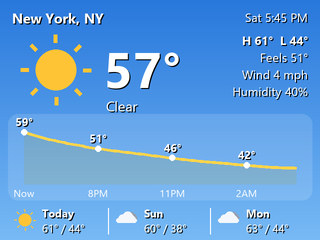
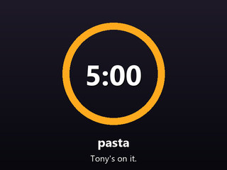
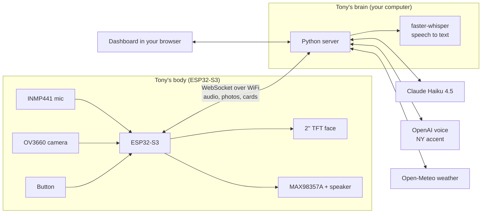

# Tony: your desktop AI assistant, from New York

> "Ay, it's 57 and sunny out there. Beautiful day. Go touch some grass, will ya?"

Tony is a little desktop robot with a face, ears, a voice and a camera. Say **"Hey Tony"** and ask him anything:
he answers fast (Claude Haiku), with a thick Brooklyn accent and a wiseguy sense of humor. Ask about the weather
and he puts a live forecast card on his screen. Turn on his camera and he can see what you're up to, and turn it
off whenever you want.

**Built with:** ESP32-S3 (C++ / PlatformIO) · Python (FastAPI, WebSockets, asyncio) · Claude Haiku 4.5 with tool use ·
faster-whisper (local speech-to-text) · ElevenLabs / OpenAI text-to-speech · Open-Meteo.

**What this project covers:** embedded firmware, a real-time audio streaming protocol, an LLM tool-use loop,
a custom animated face, wiring and power design, and a browser dashboard, all working together.

<p align="center">
  
  &nbsp;
  
</p>

## What he can do

- **Talk.** Wake word "Tony", then plain conversation. After he answers you've got 8 seconds to keep going without
  saying his name again. He remembers the last 10 back-and-forths.
- **Weather, anywhere.** "What's the weather in New York?" gets a spoken answer and a forecast card: current
  conditions, a 12-hour temperature chart with rain chances, and the next three days.
- **Timers.** "Set a pasta timer for 10 minutes." A countdown card, and he tells you when it's done.
- **See.** With the camera on, every question comes with a fresh photo, so "What am I holding?" or "How do I look?"
  just work.
- **Camera on/off.** Double-tap his button, say "Tony, turn your camera off", or click it on the dashboard. A red
  light on the board means the camera is on. Off really means off: the camera driver is shut down.
- **Emotions.** His eyes and eyebrows go happy, excited, skeptical, surprised, sleepy, confused and more to match
  what he's saying, and his mouth moves with his voice.
- **Sleep.** Hold the button, or tell him to take a nap. Mic and camera go off until you wake him.
- **Dashboard.** A web page on your computer: chat by typing, see his cards, peek through the camera, change the
  volume, or hear Tony through your computer speakers.

## How it works

The ESP32 is Tony's **body**. His **brain** runs on your computer as a small Python server. The body streams
microphone audio to the brain over WiFi; the brain does the listening, thinking and talking, and streams back his
voice, his expressions and his screen cards.



Why split it this way? The ESP32 is great at real-time audio and drawing, and terrible at speech recognition, API
juggling and image rendering. Putting the brain on your computer keeps Tony fast, makes him easy to change (edit
Python, restart, done: no re-flashing), and keeps your API keys off the device.

Speed tricks: speech-to-text runs locally, Claude's reply is streamed, and Tony starts talking as soon as the first
sentence is ready instead of waiting for the whole answer. The camera photo is taken while you're still being
transcribed.

## Hardware

See **[PARTS_LIST.md](PARTS_LIST.md)** for everything you need (about $15-25 of extras on top of the ESP32 board,
screen, mic, speaker and cells), and **[schematic/WIRING.md](schematic/WIRING.md)** for the wiring, pin by pin.

The [`3d-printed-stand/`](3d-printed-stand) folder is reserved for the stand's design files (not added yet).

## Setup

### 1. The brain (your computer)

You need **Python 3.11 to 3.13**. Run these in Windows PowerShell, not WSL: a server inside WSL is hidden from your
network by default, so the ESP32 couldn't reach it.

```powershell
cd server
py -3.13 -m venv .venv
.\.venv\Scripts\activate
pip install -r requirements.txt
copy .env.example .env
```

Open `server/.env` and fill in:

- `ANTHROPIC_API_KEY`: **required**, from [console.anthropic.com](https://console.anthropic.com).
- `OPENAI_API_KEY` or `ELEVENLABS_API_KEY`: **recommended**. Either one gives Tony his New York accent
  ([platform.openai.com](https://platform.openai.com), [elevenlabs.io](https://elevenlabs.io)). For ElevenLabs,
  also set `tts.provider: elevenlabs` and `tts.elevenlabs_voice_id` in `config.yaml`. With neither key he uses a
  free Microsoft voice: still funny, but no accent.
- `DEVICE_TOKEN`: make up a password (letters and digits). The ESP32 has to send the same one.

Then start him:

```powershell
python -m tony
```

The first start downloads the speech-to-text model (about 150 MB). When it's up, it prints the address to put in
the firmware and the dashboard link: **http://localhost:8765**. You can already chat with Tony on the dashboard
before the hardware is built.

If Windows asks whether Python can use the network, allow it on **private networks**, or the ESP32 can't reach the
server.

### 2. The body (ESP32-S3)

Install [PlatformIO](https://platformio.org/install) (the VS Code / Cursor extension is easiest).

1. Copy `firmware/include/secrets.example.h` to `firmware/include/secrets.h` and fill in your WiFi name and
   password, the server address the server printed (`TONY_SERVER_HOST`), and the same `DEVICE_TOKEN`.
   2.4 GHz WiFi only: the ESP32 can't see 5 GHz networks.
2. Plug the board in with a USB-C data cable, with the battery switched off. The board has two USB-C ports: use
   the one wired to the USB-serial chip (usually labeled **COM** or **UART**), so the serial monitor works.
3. Build and upload:

   ```powershell
   cd firmware
   pio run -t upload
   pio device monitor
   ```

   If the upload can't connect, hold **BOOT**, tap **RESET**, release **BOOT**, and try again.

Tony shows his splash screen, connects, and says hi.

## Using Tony

| Do this | And Tony... |
|---|---|
| Say "Hey Tony, ..." | Listens, thinks, answers |
| Keep talking right after he answers | Hears you without his name, for 8 seconds |
| **Tap** the button | Listens right away, no name needed. Tapping while he talks cuts him off |
| **Double-tap** the button | Camera on/off. Red light = on |
| **Hold** the button (about a second) | Goes to sleep (mic and camera off). Hold or tap again to wake him |

Things to try:

- "Hey Tony, what's the weather in New York?"
- "Tony, is it gonna rain tomorrow in Chicago?"
- "Tony, set a timer for 5 minutes for the eggs."
- "Tony, turn your camera on. What do you think of my shirt?"
- "Tony, tell me a joke about the subway."
- "Tony, turn off your camera and take a nap."

The screen: the top bar shows WiFi and server status, a mic icon when he's listening without his name, a camera
icon when it's on, and the battery. The bottom line shows what he heard and what he's up to.

### Privacy

- The camera is **off by default** and remembers its setting across restarts.
- When it's off, the camera driver is shut down and no photo can be taken. When it's on, the red light is lit,
  and photos go to Claude only alongside your questions. Photos and audio are never saved to disk.
- With the default local speech-to-text, your voice never leaves your computer. Only the text of what you say to
  Tony (after his name or a tap) goes to Claude. If you switch `stt.provider` to `openai`, everything the mic picks
  up is sent to OpenAI to be transcribed.
- The dashboard only opens on the computer running the server unless you change `dashboard_lan_access`.

## Make him yours

Everything about how he behaves is in [`server/config.yaml`](server/config.yaml), with comments:

- `you.name` and `you.home`: what he calls you, and the default city for weather.
- `units`: `imperial` or `metric`.
- `wake.words`, `wake.follow_up_seconds`: his name and how long he keeps listening.
- `tts`: voice, accent instructions, volume. Try a different `openai_voice` (`ash`, `onyx`, `verse`, ...) or tweak
  `openai_instructions` to change how thick the accent is, or switch `provider` to `elevenlabs`.
- `claude.web_search: true`: lets him look up news and scores (costs extra per search).
- `stt.local_model`: `tiny.en` for a slower computer, `small.en` for better hearing.

His personality lives in [`server/tony/personality.py`](server/tony/personality.py).

## Troubleshooting

| Problem | Fix |
|---|---|
| Screen says "Lookin' for my server..." | Is `python -m tony` running? Is `TONY_SERVER_HOST` your computer's current IP? Did Windows Firewall block Python? Do the `DEVICE_TOKEN`s match? |
| Screen is white, or the colors are inverted or swapped | See the display tips in [WIRING.md](schematic/WIRING.md#tips) |
| He doesn't hear you | Watch the server console: it logs everything he hears. Too quiet: lower `MIC_SHIFT` in `firmware/src/Audio.cpp`. Hears his name wrong: add the misspelling to `wake.words` |
| He reboots when he talks | Add or enlarge the capacitor on the amp; check the battery is charged |
| Crackly or no sound | Check BCLK/LRC/DIN, keep the I2S wires short, and make sure the microSD slot is empty |
| No accent | Set `OPENAI_API_KEY` (or `ELEVENLABS_API_KEY`) in `server/.env`. The console prints which voice he's using at startup |
| Camera won't turn on | Reseat the camera ribbon. The server console logs camera errors |

## Development

```powershell
cd server
pip install -r requirements-dev.txt
python -m pytest
```

The tests cover the sentence splitter, voice activity detection, weather parsing and cards, the Claude tool loop,
and the conversation flow (with a fake device, so no hardware or API keys needed).

## Project layout

```
Tony-AI-Assistant/
├── README.md                 you are here
├── PARTS_LIST.md             what to buy
├── LICENSE                   MIT
├── schematic/
│   ├── WIRING.md             pin-by-pin wiring
│   └── tony_wiring.svg       wiring diagram
├── 3d-printed-stand/         stand design files go here
├── docs/                     images for this README
├── firmware/                 Tony's body: ESP32-S3, PlatformIO
│   ├── platformio.ini
│   ├── include/              pins.h, config.h, secrets.example.h
│   └── src/
│       ├── main.cpp          ties it together: button, screen, camera, server messages
│       ├── TonyFace.*        the animated face
│       ├── Display.*         screen setup, status bar, captions, cards
│       ├── Audio.*           mic in, speaker out
│       ├── Camera.*          OV3660 on/off and snapshots
│       ├── Net.*             WiFi + WebSocket link to the server
│       └── Button.h, Battery.h, RingBuffer.h
└── server/                   Tony's brain: Python
    ├── config.yaml           how Tony behaves
    ├── .env.example          API keys go in .env
    ├── tony/
    │   ├── __main__.py       python -m tony
    │   ├── web.py            web server, device + dashboard connections
    │   ├── hub.py            the conversation: listening, thinking, talking
    │   ├── brain.py          Claude, with tools and memory
    │   ├── personality.py    who Tony is
    │   ├── tools.py          weather, timers, camera, sleep
    │   ├── weather.py        Open-Meteo forecasts
    │   ├── cards.py          weather and timer screen cards
    │   ├── listener.py       voice activity detection
    │   ├── stt.py            speech to text
    │   ├── tts.py            his voice
    │   ├── speech.py         streams his voice to the speaker
    │   ├── device.py         talking to the ESP32
    │   ├── protocol.py       the message format between the two
    │   └── static/           the dashboard
    └── tests/
```

## Credits

Tony's face is adapted from the Rocky face in [cgro00/desk-robot](https://github.com/cgro00/desk-robot) (MIT
license), by way of the TFT-Testing project. New York attitude added locally.

## License

[MIT](LICENSE).
