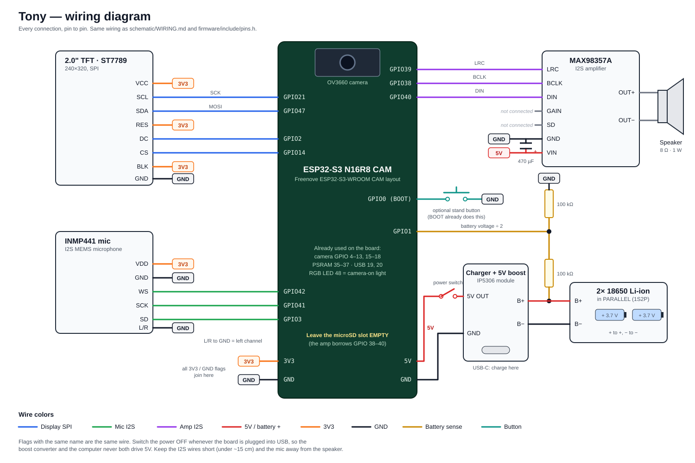

# Wiring Tony



Everything hangs off the ESP32-S3 N16R8 CAM board. The camera is already connected by its ribbon, so you're wiring
four things: the display, the microphone, the amplifier + speaker, and the battery pack. The pin numbers below are
the same ones in [`firmware/include/pins.h`](../firmware/include/pins.h); if you change a wire, change it there too.

"3V3" and "GND" mean the board's 3V3 and GND pins. Every module's GND goes to the same ground.

## 2" TFT display (ST7789, SPI)

| Display pin | Connect to | Notes |
|---|---|---|
| VCC | 3V3 | |
| GND | GND | |
| SCL | GPIO 21 | SPI clock (some boards label it SCK or CLK) |
| SDA | GPIO 47 | SPI data in (MOSI). It's not I2C, whatever the label says |
| RES | 3V3 | The panel resets itself at power-up |
| DC | GPIO 2 | Data/command (sometimes RS or A0) |
| CS | GPIO 14 | |
| BLK | 3V3 | Backlight always on (sometimes BL or LED) |

## INMP441 microphone (I2S in)

| Mic pin | Connect to | Notes |
|---|---|---|
| VDD | 3V3 | **3.3 V only.** 5 V kills it |
| GND | GND | |
| L/R | GND | Puts the mic on the left channel, which is what the firmware reads |
| WS | GPIO 42 | Word select |
| SCK | GPIO 41 | Bit clock |
| SD | GPIO 3 | Serial data out of the mic |

## MAX98357A amplifier + speaker (I2S out)

| Amp pin | Connect to | Notes |
|---|---|---|
| VIN | 5 V rail | From the power switch (see below). Louder and cleaner than 3V3 |
| GND | GND | |
| BCLK | GPIO 38 | |
| LRC | GPIO 39 | |
| DIN | GPIO 40 | |
| GAIN | not connected | 9 dB. Plenty for a 1 W speaker; volume is set in software |
| SD | not connected | Amp always on, mixing left + right |
| OUT+ / OUT− | Speaker + / − | **Never connect either speaker wire to GND.** The outputs are bridged |

Put a **470 µF (or bigger) capacitor across VIN and GND, right at the amp**: + leg to VIN, striped leg to GND. Speaker
peaks pull current fast, and without it the ESP32 can brown out and reboot mid-sentence.

GPIO 38–40 normally go to the board's microSD slot. **Leave the slot empty** or the card will fight the amp.

## Power

```
2× 18650 in parallel ──> IP5306 charge/boost module ──> slide switch ──> 5 V rail ──> board 5V pin
   (B+ / B−)               (USB-C in = charging)                              └──> amp VIN
```

| From | To | Notes |
|---|---|---|
| Battery holder + | IP5306 B+ | |
| Battery holder − | IP5306 B− | |
| IP5306 5V OUT | Slide switch, middle pin | |
| Slide switch, outer pin | 5 V rail: board **5V** pin + amp VIN | |
| IP5306 GND | GND | Shared with everything else |

- **The two 18650s go in parallel** (+ to +, − to −): 3.7 V with double the runtime. Not in series: 7.4 V would cook
  the charger. Charge both cells to the same voltage before you connect them, and use the same make and model.
- **Switch the power off whenever the board is plugged into your computer over USB**, so the boost module and the
  computer aren't both driving 5 V. Flashing and serial monitoring work fine with the battery switched off.
- Charge the pack through the IP5306's USB-C port. It works with the switch on or off.
- Some IP5306 boards turn their 5 V off when the current is very low. Tony's ESP32 with WiFi on draws more than
  that, so it stays on. If yours keeps shutting down anyway, see the alternatives in
  [`PARTS_LIST.md`](../PARTS_LIST.md).

## Battery gauge (optional)

| From | To |
|---|---|
| Battery + (B+) | 100 kΩ resistor → GPIO 1 |
| GPIO 1 | 100 kΩ resistor → GND |

The two resistors halve the battery voltage so GPIO 1 can measure it, and the status bar shows a percentage. Skip
this and set `BATTERY_SENSE` to `0` in `pins.h`; the battery icon just disappears.

## Stand button (optional)

The board's **BOOT** button is Tony's button. For a bigger one on the stand, wire a push button from **GPIO 0 to
GND**, in parallel with BOOT. Don't hold it while powering on, or the board boots into flashing mode.

## Tips

- **Keep the I2S wires short** (under about 15 cm), and keep the microphone away from the speaker and the
  amplifier. Long or tangled clock wires mean crackly audio.
- **Display colors look wrong?** If black shows as white, flip `cfg.invert` in `firmware/src/Display.h`. If red and
  blue are swapped, flip `cfg.rgb_order`.
- **Mic too quiet or clipping?** Change `MIC_SHIFT` in `firmware/src/Audio.cpp`: one less doubles the gain.
- **Camera upside down?** Change `set_vflip` in `firmware/src/Camera.cpp`.
- Solder the modules to perfboard, or use female jumpers on the headers. Breadboards get flaky with I2S audio.
